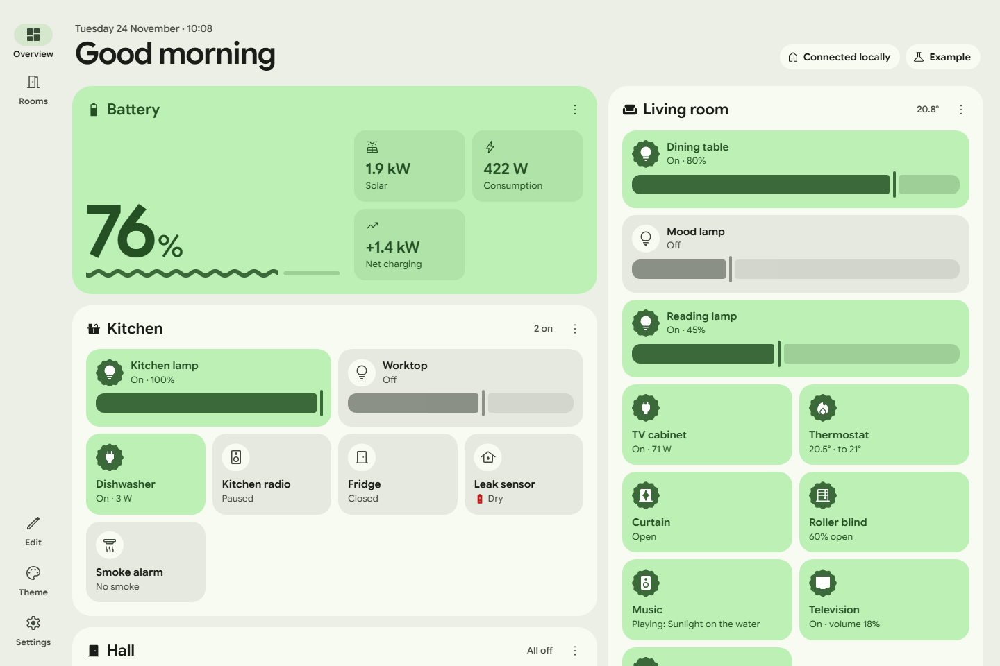
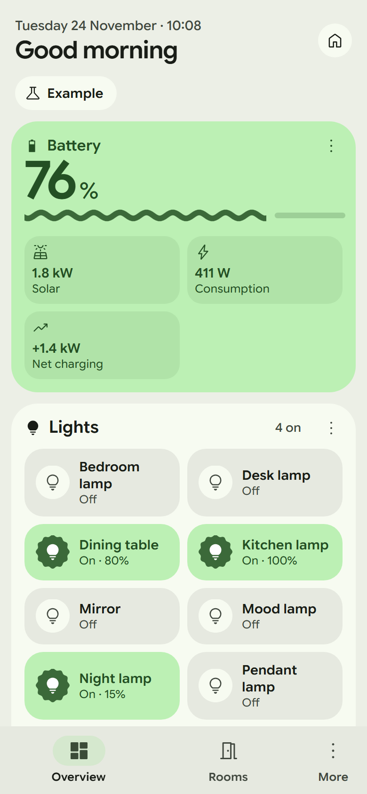
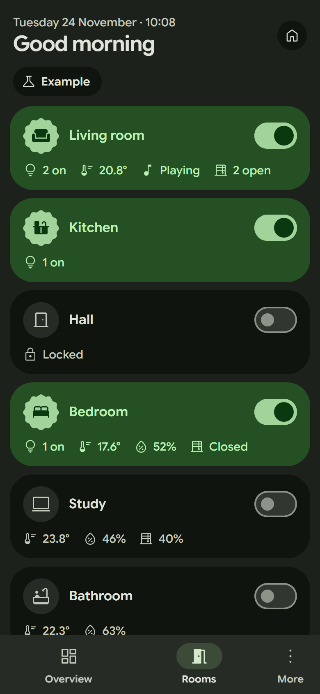
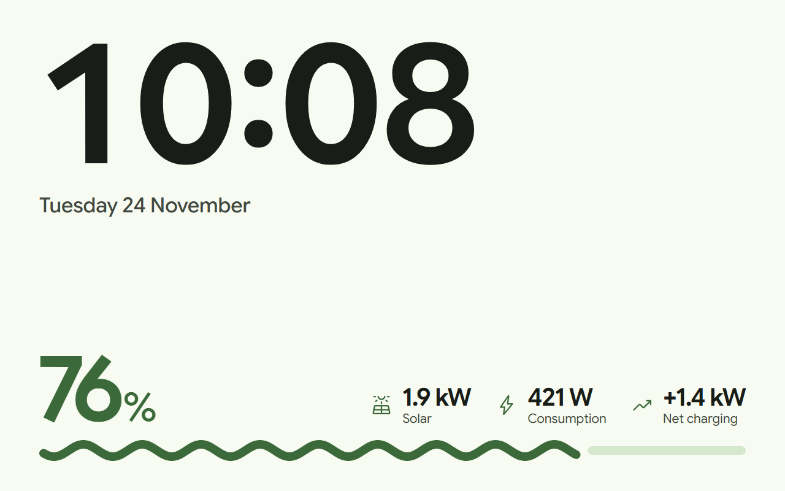

# Expressive Home

*[Nederlands](README.nl.md)*

A dashboard for Homey Pro that puts design first, in the style of Material 3 Expressive. You get a dashboard of your own devices right away, and arrange it afterwards the way you like. It works on a laptop, a tablet on the wall and a phone, also without internet.

This is version 1.0.0. It is not in the Homey App Store yet; below is how to put it on your own Homey.



| Phone | Rooms, in the dark | Rest screen of a wall tablet |
|---|---|---|
|  |  |  |

## What it does

- **A dashboard that makes itself** from your devices: lights, sockets, heating and air conditioning, curtains and blinds, music and television, energy, water, security and flows, with a hero for the battery.
- **Rooms**: a card per room with its lights, temperature and what plays, and everything in it one tap away. Or the whole overview per room.
- **Nothing dangerous with one tap**: unlocking, opening a garage door and turning off an alarm have to be held, or are asked about first.
- **Arrange it yourself**: drag tiles and sections, own names and icons, single values, more dashboards, a colour per section. Every step can be undone, and it can be kept as a file.
- **Light, dark or automatic**, any base colour, roomy or compact, Dutch and English.
- **Phone**: a layout of its own, with dimming by holding a lamp and swiping.
- **Wall tablet**: a rest screen with a large clock, the battery, temperatures and what needs attention, and almost black at night.
- **Without internet**: a small app on the Homey serves the dashboard on your own network.
- **Accessible**: everything works with a keyboard and a screen reader, and "reduced motion" is followed.

There is no account and no server of ours. You can look around without a Homey, in an example house or a camper van.

## Two ways to use it

| | In the browser | Through the app on the Homey |
|---|---|---|
| For | Trying it out, also away from home | Every device at home, also without internet |
| Signing in | One API key of your Homey, which stays in that browser | Scan a code once on every device |
| Dashboards | Per browser | On the Homey, the same on every device |

## In the browser

You need [Node.js](https://nodejs.org) 24 and npm 11.

```
npm install
npm run vendor
npm start
```

`npm run vendor` fetches the browser build of `homey-api` from Athom and checks it against a fixed checksum. Without it only the example Homey works. `npm start` builds the app and opens `http://localhost:5274/`. You make the key on my.homey.app at Settings → API Keys; the connect screen says which rights are needed.

## On the Homey

You need a Homey Pro, and internet once to install.

```
npm install
npm run homey-app
cd homey-app
npm ci
npx homey@4.6.3 login
npx homey@4.6.3 app install
```

Then open the settings of the app: More → Apps → Expressive Home → Settings. Scan the code there with the camera of a tablet, phone or laptop on the same Wi-Fi, and tap Pair. Without a camera you open the address (`http://<ip address of your Homey>:8790`) and type the code. Per device you choose whether it may also edit.

To start a flow from the dashboard, give it the card of Expressive Home: "A dashboard button was pressed". Every name on that card is a button on the dashboard. Homey does not let an app start other flows; for those you can add an API key in the settings that may only do that ("Start flows").

The connection is `http`, so it is not encrypted. Use it on your own network only, and never open the port to the internet.

## Something wrong, or an idea?

Open an [issue](https://github.com/DIMENTS/expressive-home/issues): what you did, what you saw, on which device and browser, and which Homey Pro. Leave out keys, codes, addresses and the names of your devices.

## Building and testing

| Command | What it does |
|---|---|
| `npm run dev` | Development server on `http://localhost:5273/`, with `galerij.html` for all parts side by side |
| `npm run check` | Types and tests |
| `npm run smoke` | The built app in Chromium and WebKit (once before: `npm run vendor` and `npx playwright install chromium webkit`) |
| `npm run smoke:homey` | The app on the Homey and its settings, with a stand-in for the hub |
| `npm run readme-images` and `npm run store-images` | The pictures, from the example house (once before: `npm run build`) |
| `npm run app-store` | Builds the app and has the Homey CLI check it for the store |

The code is TypeScript with [Lit](https://lit.dev) and no other framework.

## License

Copyright © 2026 DIMENTS. [GPL-3.0](LICENSE). As an additional permission under section 7 of that license, you may combine this program with the package `homey-api` of Athom B.V. and convey the result.

Uses [Lit](https://lit.dev) (BSD-3-Clause), [Material Color Utilities](https://github.com/material-foundation/material-color-utilities) and [Material Symbols](https://fonts.google.com/icons) (Apache-2.0) and Google Sans Flex (OFL-1.1). `homey-api` belongs to Athom and is not in this repository; it is fetched when you install.

This project is not affiliated with Athom or Google. Homey is a trademark of Athom B.V.; Material Design is by Google.
