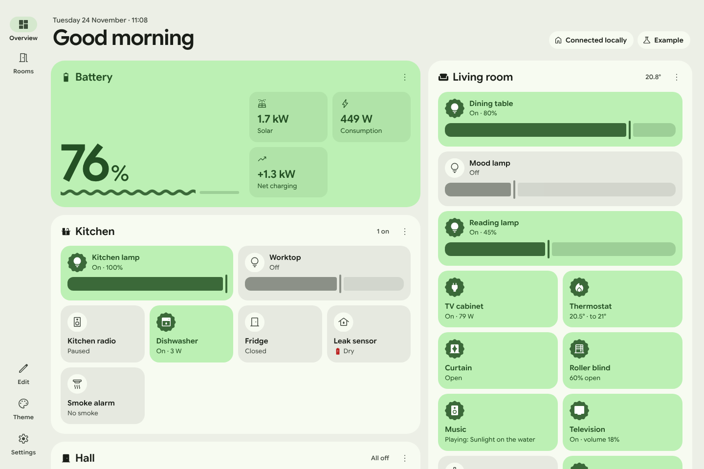
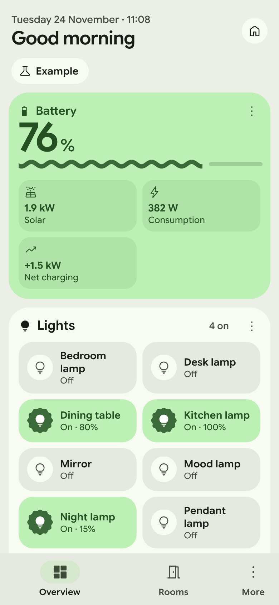
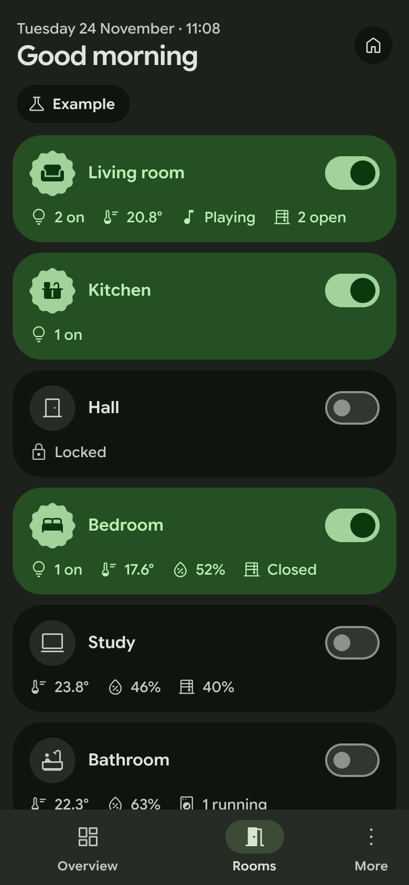
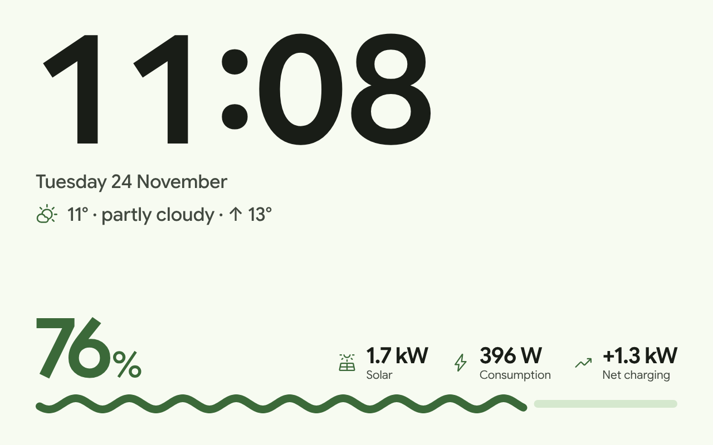

# Expressive Home

*[English](README.md)*

Een dashboard voor Homey Pro waarin het ontwerp voorop staat, in de stijl van Material 3 Expressive. Je krijgt meteen een samengesteld dashboard van je eigen apparaten, en richt het daarna in zoals je wilt. Het werkt op een laptop, een tablet aan de muur en een telefoon, ook zonder internet.

Dit is versie 1.0.0. Hij staat nog niet in de Homey App Store; hieronder staat hoe je hem op je eigen Homey zet.



| Telefoon | Kamers, in het donker | Rustbeeld van een wandtablet |
|---|---|---|
|  |  |  |

## Wat het doet

- **Een dashboard dat vanzelf ontstaat** uit je apparaten: lampen, stekkers, verwarming en airco, gordijnen en zonwering, muziek en tv, energie, water, beveiliging en flows, met een blikvanger voor de accu.
- **Kamers**: een kaart per kamer met de lampen, de temperatuur en wat er speelt, en alles wat er staat op één tik afstand. Of het hele Overzicht per kamer.
- **Niets gevaarlijks met één tik**: ontgrendelen, een garagedeur openen en het alarm uitzetten vragen vasthouden, of stellen eerst een vraag.
- **Zelf inrichten**: tegels en secties verslepen, eigen namen en iconen, losse waarden, meer dashboards, een kleur per sectie. Stap voor stap ongedaan te maken, en als bestand te bewaren.
- **Licht, donker of automatisch**, elke basiskleur, ruim of compact, Nederlands en Engels.
- **Telefoon**: een eigen indeling met dimmen door een lamp vast te houden en te vegen.
- **Wandtablet**: een rustbeeld met een grote klok, de accu, temperaturen en wat aandacht vraagt, en 's nachts bijna zwart.
- **Zonder internet**: een appje op de Homey toont het dashboard op je eigen netwerk.
- **Toegankelijk**: alles werkt met het toetsenbord en een schermlezer, en "minder beweging" wordt gevolgd.

Er is geen account en geen eigen server. Rondkijken kan zonder Homey, in een voorbeeldhuis of in een camper.

## Twee manieren om het te gebruiken

| | In de browser | Via het appje op de Homey |
|---|---|---|
| Waarvoor | Uitproberen, en [onderweg](#onderweg) | Elk apparaat thuis, ook zonder internet |
| Inloggen | Eén API-sleutel van je Homey, die in die browser blijft | Op elk apparaat één keer een code scannen |
| Dashboards | Per browser, of gelijk met de Homey als je hem koppelt aan het appje | Op de Homey, op elk apparaat gelijk |

## In de browser

Nodig: [Node.js](https://nodejs.org) 24 en npm 11.

```
npm install
npm run vendor
npm start
```

`npm run vendor` haalt de browserversie van `homey-api` op bij Athom en controleert die op een vaste controlesom. Zonder die stap werkt alleen de voorbeeld-Homey. `npm start` bouwt de app en opent `http://localhost:5274/`. De sleutel maak je op my.homey.app bij Instellingen → API-sleutels; het verbindscherm zegt welke rechten nodig zijn.

## Onderweg

Het dashboard staat ook online, op **https://diments.github.io/expressive-home/**. Rondkijken in het voorbeeldhuis of de camper kan daar meteen. Met een sleutel praat het thuis rechtstreeks met je Homey, en onderweg via de Homey-cloud.

- Maak voor elke telefoon een **eigen sleutel**, met de naam van die telefoon. Raak je de telefoon kwijt, verwijder dan op my.homey.app alleen die sleutel.
- Zet de pagina **eerst op je beginscherm** en verbind daarna, vanaf het beginscherm. Op een iPhone heeft een web-app op het beginscherm een eigen opslag, die Safari niet na zeven dagen wist.
- De pagina komt van GitHub, je sleutel niet: die blijft in je browser en gaat alleen naar je Homey. Wie je ontgrendelde telefoon heeft, kan wat je sleutel mag; slot, garage en alarm vragen altijd om vasthouden of bevestigen.
- Binnen een andere website opent het dashboard niet; open het in een eigen tabblad.
- **Dezelfde dashboards als thuis**: heb je het appje op je Homey, kies dan in de Homey-app bij de instellingen van Expressive Home **Een telefoon voor onderweg koppelen**, en typ de code van acht cijfers op de telefoon bij Instellingen → Gelijk met je Homey. Daarna zijn indeling, thema's en widgets hier en thuis hetzelfde, via de Homey-cloud. Eigen widgets verander je alleen thuis.

## Op de Homey

Nodig: een Homey Pro, en één keer internet om te installeren.

```
npm install
npm run homey-app
cd homey-app
npm ci
npx homey@4.6.3 login
npx homey@4.6.3 app install
```

Open daarna de instellingen van het appje: Meer → Apps → Expressive Home → Instellingen. Scan de code met de camera van een tablet, telefoon of laptop op dezelfde wifi, en tik op Koppelen. Zonder camera open je het adres (`http://<ip-adres van je Homey>:8790`) en typ je de code over. Per apparaat kies je of het ook mag bewerken.

Een flow starten vanaf het dashboard kan met de kaart van Expressive Home: "Er is op een dashboardknop gedrukt". Elke naam op die kaart is een knop op het dashboard. Andere flows mag een app van Homey niet starten; daarvoor kun je in de instellingen een API-sleutel met alleen het recht "Flows starten" toevoegen.

De verbinding is `http` en dus niet versleuteld. Gebruik hem alleen op je eigen netwerk, en zet de poort nooit open naar het internet.

## Werkt er iets niet, of heb je een idee?

Open een [issue](https://github.com/DIMENTS/expressive-home/issues): wat je deed, wat je zag, op welk apparaat en in welke browser, en welke Homey Pro je hebt. Laat sleutels, codes, adressen en de namen van je apparaten weg. Nederlands mag.

## Bouwen en testen

| Opdracht | Wat het doet |
|---|---|
| `npm run dev` | Ontwikkelserver op `http://localhost:5273/`, met `galerij.html` voor alle onderdelen naast elkaar |
| `npm run check` | Types en tests |
| `npm run build:pages` | Alleen de app, zoals hij op GitHub Pages komt, in `dist-pages/`; bij elke push naar `main` doet `.github/workflows/pages.yml` dat |
| `npm run smoke` | De gebouwde app in Chromium en WebKit (eerst één keer `npm run vendor` en `npx playwright install chromium webkit`) |
| `npm run smoke:homey` | Het appje op de Homey en zijn instellingen, met een nagebootste Homey |
| `npm run readme-images` en `npm run store-images` | De plaatjes, uit het voorbeeldhuis (eerst één keer `npm run build`) |
| `npm run app-store` | Bouwt het appje en laat het hulpmiddel van Homey het nakijken voor de winkel |

De code is TypeScript met [Lit](https://lit.dev) en zonder ander raamwerk. Alle uitleg in de code is Engels.

## Licentie

Copyright © 2026 DIMENTS. [GPL-3.0](LICENSE). Met als aanvullende toestemming onder artikel 7 van die licentie: je mag dit programma samenvoegen met het pakket `homey-api` van Athom B.V. en het geheel verspreiden.

Gebruikt: [Lit](https://lit.dev) (BSD-3-Clause), [Material Color Utilities](https://github.com/material-foundation/material-color-utilities) en [Material Symbols](https://fonts.google.com/icons) (Apache-2.0) en Google Sans Flex (OFL-1.1). `homey-api` is van Athom en zit niet in deze map; het wordt bij het installeren opgehaald.

Dit project hoort niet bij Athom of Google. Homey is een merk van Athom B.V.; Material Design is van Google.
